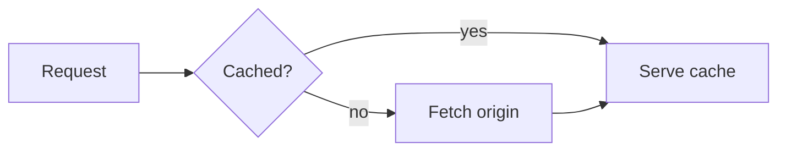

# claude-mermaid-mod

[Tiếng Việt](README.vi.md)

A Claude Code mod that draws ```` ```mermaid ```` blocks in Claude's replies as Unicode diagrams, in place.

Before:

````

````

After:

```
┌─────────┐    ╔═════════╗ no  ┌──────────────┐    ┌─────────────┐
│ Request ├───▶║ Cached? ╟────▶│ Fetch origin ├───▶│ Serve cache │
└─────────┘    ╚════╤════╝     └──────────────┘    └─────────────┘
                    │                                     ▲
                    └──────────────── yes ────────────────┘
```

By default the diagram is drawn above its code block, so the source stays readable and copyable. `/mermaid diagram` hides the code block. The mod changes only what the terminal draws. The stored message keeps its Mermaid source, and `ctrl+o` shows it.

## Install

Requires Claude Code 2.1.287 or later.

```sh
claude plugin marketplace add ngothanhluc/claude-mermaid-mod
claude plugin install mermaid-mod@claude-mermaid-mod
```

## What it draws

The mod renders flowcharts, state, class, ER, sequence, pie, mindmap, timeline and gitGraph diagrams. It colours borders, text, edges, edge labels and titles with your Claude Code theme.

It keeps the original code block when:

- the diagram type is not supported (for example `gantt`),
- the diagram is wider than the terminal (resize the window and it redraws),
- the source has errors. A warning line under the block says what failed.

## Settings

| Command | Effect |
| --- | --- |
| `/mermaid` | Show the current settings. |
| `/mermaid streaming` | Draw every Mermaid block, including one still being written. This is the default. |
| `/mermaid final` | Draw only blocks whose closing fence has arrived. |
| `/mermaid off` | Draw nothing. Code blocks stay as they are. |
| `/mermaid both` | Draw the diagram above its code block. This is the default. |
| `/mermaid diagram` | Draw the diagram in place of its code block. |

Settings are saved for every session on the machine.

## Development

```sh
npm install          # esbuild and lovely-mermaid, for the vendor script only
npm test             # node --test on the transform, then claude plugin test on the hooks
npm run golden       # rewrite test/fixtures/*.txt from the .mmd inputs
npm run vendor       # rebuild hooks/vendor/lovely-mermaid.js from the pinned version
claude --plugin-dir . # try it in a live session
```

`src/transform.ts` is a pure function from reply text to segments, and holds all the logic. `hooks/register.ts` connects it to Claude Code's `AssistantMessage` render hook and the `/mermaid` command.

## Credits

This is a port of the Mermaid rendering built into the [pi coding agent](https://github.com/earendil-works/pi), added in [pi#7624](https://github.com/earendil-works/pi/pull/7624) by [@xl0](https://github.com/xl0). Diagrams are drawn by [lovely-mermaid](https://github.com/xl0/lovely-mermaid), vendored under its Apache-2.0 license in `hooks/vendor/`.

## License

MIT
