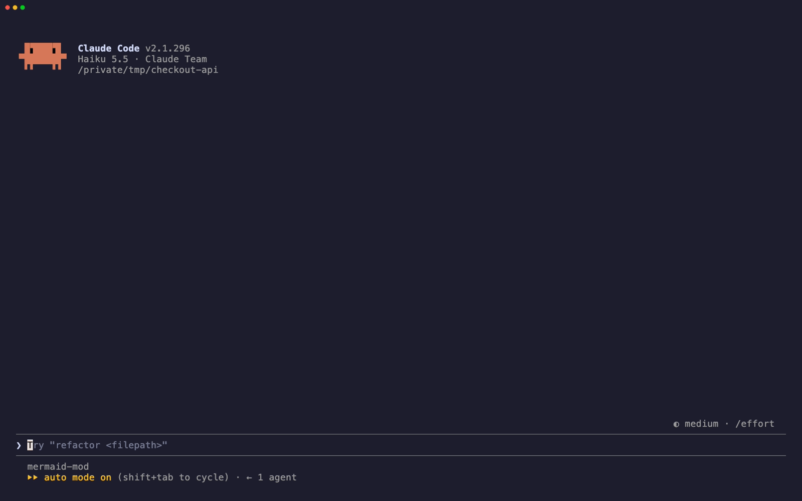
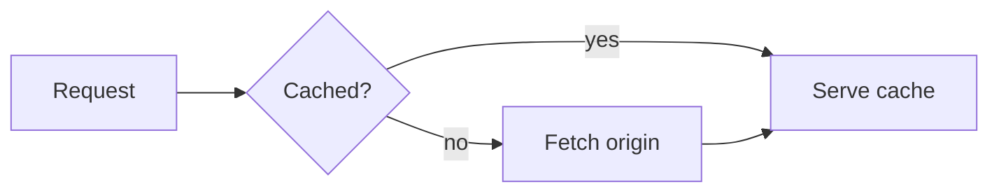
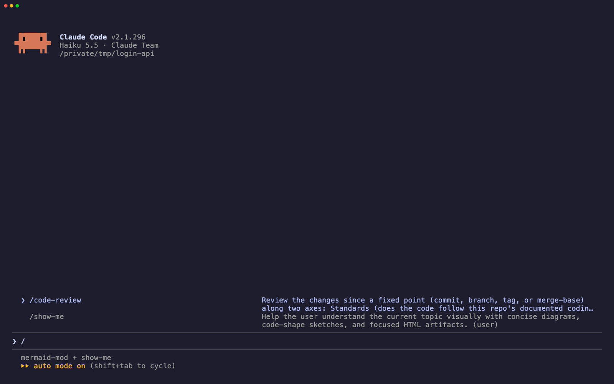

<h1 align="center">claude-mermaid-mod</h1>

<p align="center"><a href="README.md">🇬🇧 English</a></p>

Mod cho Claude Code, vẽ các khối ```` ```mermaid ```` trong câu trả lời của Claude thành diagram Unicode ngay tại chỗ.



Trước:

````

````

Sau:

```
┌─────────┐    ╔═════════╗ no  ┌──────────────┐    ┌─────────────┐
│ Request ├───▶║ Cached? ╟────▶│ Fetch origin ├───▶│ Serve cache │
└─────────┘    ╚════╤════╝     └──────────────┘    └─────────────┘
                    │                                     ▲
                    └──────────────── yes ────────────────┘
```

Mặc định diagram được vẽ phía trên khối code, nên source vẫn đọc và copy được. `/mermaid diagram` sẽ ẩn khối code. Mod chỉ thay đổi những gì terminal hiển thị. Message lưu lại vẫn giữ nguyên source Mermaid, và `ctrl+o` sẽ hiện source đó.

## Cài đặt

Cần Claude Code 2.1.287 trở lên.

```text
/plugin marketplace add ngothanhluc/claude-mermaid-mod
/plugin install mermaid-mod@claude-mermaid-mod
```

### Dùng cùng show-me

[show-me](https://github.com/humanlayer/skills/tree/main/plugins/show-me) là skill của [HumanLayer](https://github.com/humanlayer) (MIT), giúp Claude giải thích chủ đề đang bàn bằng diagram, thường là Mermaid. Có mermaid-mod, các diagram đó được vẽ ngay trong terminal. Marketplace này có sẵn show-me, lấy trực tiếp từ repo của HumanLayer:

```text
/plugin install show-me@claude-mermaid-mod
```

Sau đó gõ `/show-me` trong bất kỳ cuộc trò chuyện nào.



Đây là skill tôi dùng nhiều nhất. Thay vì đọc cả đoạn văn giải thích một luồng chạy thế nào, tôi gõ `/show-me` và có ngay call tree hoặc diagram trong vài giây. Đó là cách nhanh nhất tôi biết để nắm một đoạn code lạ, và có mermaid-mod thì tôi không phải rời terminal để xem.

## Vẽ được những gì

Mod vẽ được flowchart, state, class, ER, sequence, pie, mindmap, timeline và gitGraph. Viền, chữ, cạnh, nhãn cạnh và tiêu đề được tô màu theo theme Claude Code của bạn.

Mod giữ nguyên khối code gốc khi:

- loại diagram chưa được hỗ trợ (ví dụ `gantt`),
- diagram rộng hơn terminal (nới rộng cửa sổ thì nó vẽ lại),
- source có lỗi. Một dòng cảnh báo dưới khối code cho biết lỗi gì.

## Cấu hình

| Lệnh | Tác dụng |
| --- | --- |
| `/mermaid` | Xem cấu hình hiện tại. |
| `/mermaid streaming` | Vẽ mọi khối Mermaid, kể cả khối đang được viết dở. Đây là mặc định. |
| `/mermaid final` | Chỉ vẽ khối đã có fence đóng. |
| `/mermaid off` | Không vẽ gì. Các khối code giữ nguyên. |
| `/mermaid both` | Vẽ diagram phía trên khối code. Đây là mặc định. |
| `/mermaid diagram` | Vẽ diagram thay cho khối code. |

Cấu hình được lưu chung cho mọi session trên máy.

## Phát triển

```sh
npm install          # esbuild và lovely-mermaid, chỉ dùng cho script vendor
npm test             # node --test cho transform, rồi claude plugin test cho hooks
npm run golden       # sinh lại test/fixtures/*.txt từ các file .mmd
npm run vendor       # build lại hooks/vendor/lovely-mermaid.js từ phiên bản đã pin
claude --plugin-dir . # chạy thử trong một session thật
vhs demo/demo.tape   # quay lại demo/demo.gif, .mp4 và .png (cần vhs)
vhs demo/show-me.tape  # quay lại demo/show-me.gif
```

Toàn bộ logic nằm ở `src/transform.ts`, một hàm thuần nhận text của câu trả lời và trả về các segment. `hooks/register.ts` nối hàm đó với render hook `AssistantMessage` của Claude Code và lệnh `/mermaid`.

## Ghi công

Đây là bản port tính năng render Mermaid có sẵn trong [pi coding agent](https://github.com/earendil-works/pi), được thêm ở [pi#7624](https://github.com/earendil-works/pi/pull/7624) bởi [@xl0](https://github.com/xl0). Diagram được vẽ bằng [lovely-mermaid](https://github.com/xl0/lovely-mermaid), vendor trong `hooks/vendor/` theo license Apache-2.0 của thư viện.

## License

MIT
